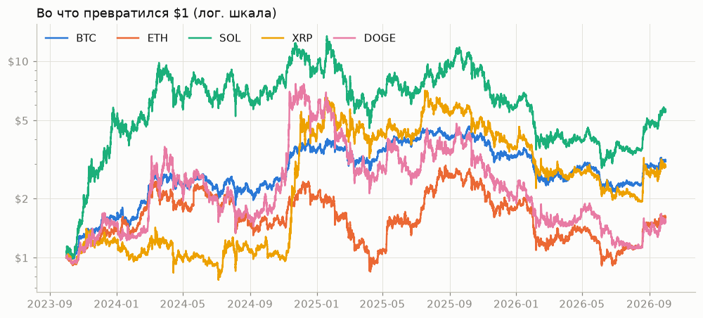
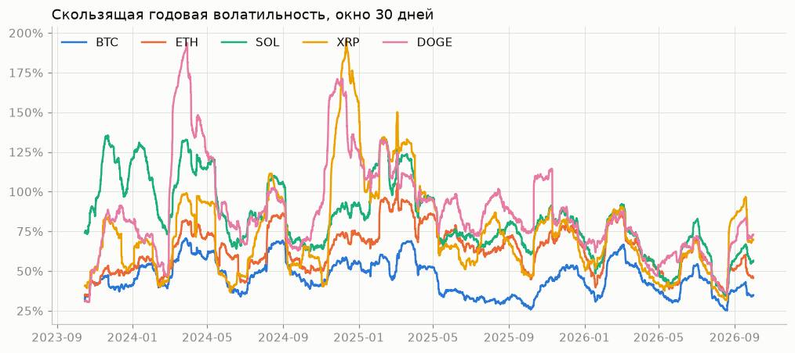
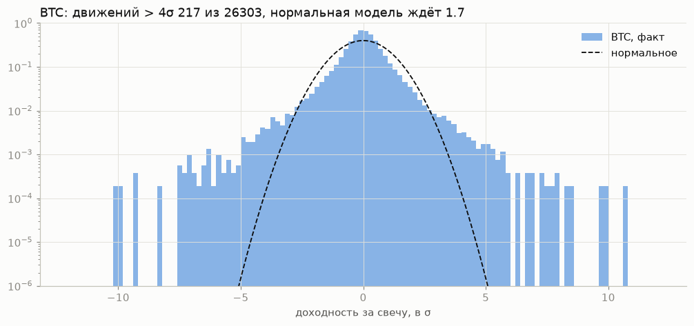
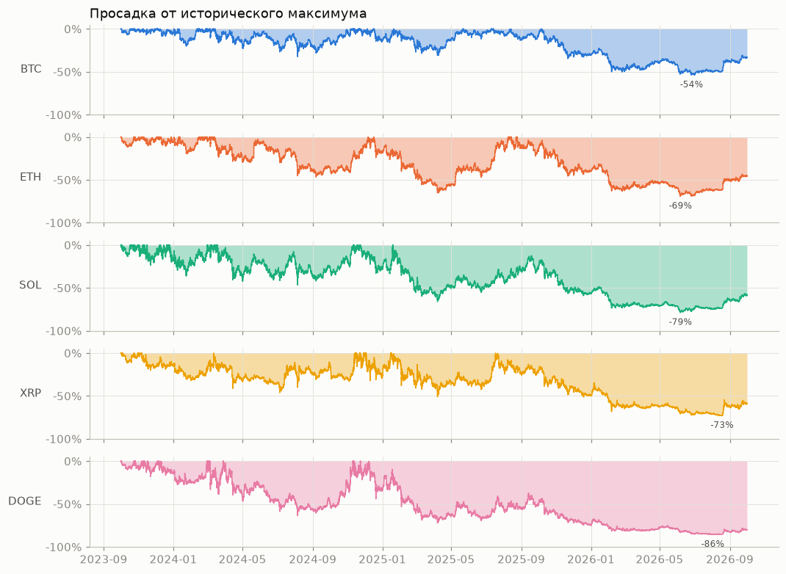
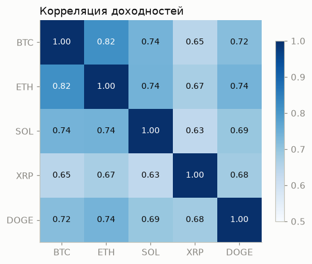

# ohlcv-lab

[](https://github.com/dI98Sk/ohlcv-lab/actions/workflows/ci.yml)

Небольшой, но настоящий пайплайн рыночных данных:
**Bybit API → сырые JSON → чистый Parquet → SQL / Polars → статистика и отчёт.**

```
ohlcv-fetch    data/raw/bybit/…/<window>.json         ответы API как есть, докачка, проверки страниц
ohlcv-clean    data/clean/symbol=…/interval=…/*.parquet  полная сетка, пропуски помечены, отчёт о качестве
ohlcv-stats    pandas: доходности, волатильность, просадки, хвосты, VaR
ohlcv-sql      DuckDB: те же расчёты SQL-запросами прямо по Parquet
polars_stats   Polars: те же расчёты ленивыми запросами
ohlcv-bench    pandas vs Polars vs DuckDB: время и память, результаты сверяются
ohlcv-report   графики и таблица ниже + notebooks/report.ipynb
```

- Основной датасет: BTC, ETH, SOL, XRP, DOGE (USDT perpetual), часовые свечи за 3 года.
- Дополнительный: BTCUSDT, минутные свечи за год — для ресемплинга и замеров скорости.

## Результаты

Часовые свечи, **[2023-10-01, 2026-10-01)** — по 26 304 на монету, без пропусков. Период
зафиксирован в коде (`ohlcv_lab.report`): данные докачиваются при каждом запуске, и без этого цифры
менялись бы каждую неделю. Таблица и графики собираются командой `make figures`.

| монета | год. волатильность | эксцесс | VaR 1% | VaR 1% (нормальный) | макс. просадка |
|--------|------:|-----:|-------:|-------:|-----:|
| BTC | 47% | 10.2 | −1.52% | −1.16% | −54% |
| ETH | 65% | 16.9 | −2.04% | −1.60% | −69% |
| SOL | 86% | 9.1 | −2.62% | −2.13% | −79% |
| XRP | 80% | 27.8 | −2.40% | −1.99% | −73% |
| DOGE | 92% | 19.6 | −2.84% | −2.30% | −86% |



**Риск отличается вдвое и не постоянен.** Волатильность кластеризуется: бурные месяцы приходят ко
всем монетам одновременно.



**Хвосты толстые.** Движений больше 4σ у BTC 217 из 26 303 часов, нормальная модель ждёт 1.7.
Нормальный VaR 1% занижает исторический на 20–30%, поэтому риск оценивается по историческому.



**Просадки глубокие, диверсификации почти нет:** корреляции часовых доходностей 0.63–0.82, в обвал
падает всё вместе.





Подробно, с отчётом о качестве данных — `notebooks/report.ipynb` (`make report` → `reports/report.html`).

## Как воспроизвести

```bash
python3.12 -m venv .venv && source .venv/bin/activate   # lock-файл собран под 3.12
make install   # точные версии из requirements.lock
make data      # сырой слой из Bybit API за [2023-10-01, 2026-10-01)
make layer     # чистый Parquet + data/clean/quality_report.json
make figures   # таблица и картинки выше
make report    # отчёт-ноутбук в HTML
make check     # ruff + pytest, как в CI
```

Окна запросов выровнены по эпохе, поэтому одни и те же свечи всегда попадают в одни и те же файлы,
а повторный запуск докачивает только недостающее. Тесты (`make test`) работают на синтетике и не
ходят в сеть; CI гоняет их на Python 3.12 с версиями из `requirements.lock` и на 3.11 с последними
версиями, которые разрешает `pyproject.toml`.

## Загрузка данных

```bash
# основной датасет: 5 монет, часовые свечи за 3 года (то же делает make data)
ohlcv-fetch --symbols BTCUSDT ETHUSDT SOLUSDT XRPUSDT DOGEUSDT --interval 60 --start 2023-10-01 --end 2026-10-01
# дополнительный: BTCUSDT, минутные свечи за год
ohlcv-fetch --symbols BTCUSDT --interval 1 --start 2025-10-01 --end 2026-10-01
```

Ответы API сохраняются как есть в `data/raw/bybit/<category>/<symbol>/<interval>/`:
один JSON на окно из 1000 свечей, окна выровнены по эпохе. Повторный запуск
докачивает только недостающее. Окно, в котором последняя свеча ещё не закрыта,
пишется как `*.partial.json` и перекачивается при следующем запуске.

Из-за выравнивания окон сырой слой начинается чуть раньше `--start` (2023-09-25 вместо
2023-10-01) и заканчивается чуть позже `--end`; отчёт берёт из него ровно свой период.

## Очистка

```bash
ohlcv-clean
```

Собирает чистый слой `data/clean/symbol=<SYMBOL>/interval=<INTERVAL>/data.parquet`
и отчёт о качестве `data/clean/quality_report.json`:

- типы приведены, индекс — `DatetimeIndex` в UTC, отсортирован, без дублей;
- незакрытая на момент выгрузки свеча отброшена;
- ряд переиндексирован на полную сетку; пропуски не интерполируются, а помечены `is_gap`;
- нарушения инвариантов OHLC помечены `bad_ohlc`, экстремальные свечи — `is_extreme`
  (по скользящим статистикам только из прошлого); ничего из этого не удаляется.

CSV против Parquet на минутном BTCUSDT (542 тыс. строк):

| формат  | размер | чтение | время после чтения |
|---------|-------:|-------:|--------------------|
| CSV     | 49.6 MB | 394 ms | строка, тип и часовой пояс потеряны |
| Parquet | 14.6 MB |  14 ms | `datetime64[ms, UTC]` |

## Доходности и статистики

```bash
ohlcv-stats                # часовые свечи, все монеты
ohlcv-stats --interval 1   # минутные
```

Печатает сводку и корреляции, пишет `data/clean/stats_<interval>.csv`. Графики в
`notebooks/returns_stats.ipynb`.

- лог-доходности для агрегации во времени, простые — для денег (просадки);
- доходность через пропуск не считается: NaN, а не скачок за несколько свечей;
- годовой пересчёт для рынка 24/7: 8760 часов, а не 252 дня;
- VaR исторический; нормальный приведён рядом для сравнения.

Итоговые цифры — в разделе «Результаты» выше.

## SQL (DuckDB)

```bash
ohlcv-sql summary                       # статистики по монетам
ohlcv-sql resample --bucket "4 hours"   # 1h -> 4h свечи
ohlcv-sql -e "SELECT symbol, count(*) FROM candles GROUP BY ALL"
```

DuckDB читает Parquet напрямую, без загрузки в pandas. Представления: `candles`
(чистый слой, `symbol` и `interval` берутся из пути), `returns`, `drawdowns`.
Готовые запросы лежат в `src/ohlcv_lab/queries/`: `rolling_vol`, `resample`,
`gaps`, `summary`, `correlation`. Каждый тестами сверяется с pandas-версией из
`stats.py` или `clean.py`.

- `TimeZone = 'UTC'` при подключении: иначе `date_trunc('day')` режет сутки по
  локальному времени машины;
- типы партиций заданы явно (`VARCHAR`): иначе `interval=60` становится числом;
- `WHERE symbol = 'BTCUSDT'` читает 1 файл из 6 (partition pruning).

## Polars и бенчмарк

`ohlcv_lab.polars_stats` — те же расчёты на ленивых запросах Polars (`scan_parquet`
→ `.collect()`): фильтр по партиции и выбор колонок уходят прямо в чтение файла
(видно в `.explain()`). Значения по умолчанию у Polars не такие, как у pandas,
поэтому они заданы явно: `skew/kurtosis(bias=False)`, `quantile(interpolation="linear")`.
Пропуск для Polars — только null, а NaN считается обычным числом.

```bash
ohlcv-bench                  # BTCUSDT 1m, 542 тыс. строк
ohlcv-bench --interval 60
```

Одна задача (доходности, 30-дневная волатильность, дневные свечи, сводка), результаты
движков сверяются перед замером. Время — лучшее из 5 запусков после прогрева, память —
пик в отдельном процессе:

| движок | 1m, 542 тыс. строк | пик памяти | 1h, 27 тыс. строк |
|--------|------:|------:|------:|
| pandas | 0.11 s | 279 MB | 0.010 s |
| Polars | 0.18 s | 390 MB | 0.015 s |
| DuckDB | 1.02 s | 323 MB | 0.059 s |

На одном ряде, который помещается в память, pandas быстрее всех: его скользящие окна и
ресемплинг написаны на C, а у Polars и DuckDB на таком объёме не окупаются накладные
расходы на планирование и (у DuckDB) перевод результата в pandas. `time_bucket` по
`TIMESTAMPTZ` в DuckDB оказался в 30 раз медленнее, чем по UTC `TIMESTAMP`; запрос
`resample` переписан.

## Структура

```
src/ohlcv_lab/   код пайплайна (импортируется как пакет ohlcv_lab)
tests/           pytest
notebooks/       ноутбуки — только вызывают функции из src/; report.ipynb — итоговый
docs/img/        картинки README (make figures)
data/            raw/ и clean/ — не коммитятся, воспроизводятся из API
Makefile         шаги пайплайна: make help
.github/         CI: ruff + pytest
```
